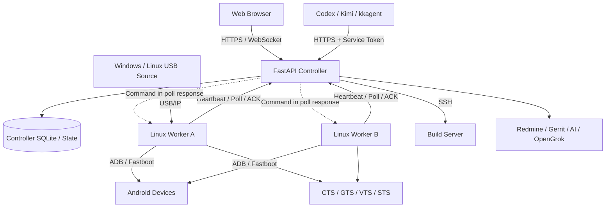

# GMS Remote Test Web

面向 Android GMS 测试的设备调度与远程测试平台。FastAPI Controller 管理认证、
Worker、设备租约、CTS/GTS/VTS/STS、固件、构建与报告；Web 和 Codex / Kimi / kkagent
通过受控接口使用这些能力。

## 核心能力

- 测试套件扫描、单/多设备任务、状态跟踪、结果与报告。
- 本地 USB、Windows / Linux USB/IP 和 ADB Proxy 设备接入，跨 Worker 库存与租约。
- Rockchip 固件与 GSI 烧写、AOA 输入与刷机后恢复、ATS 多阶段工作流。
- 构建服务器、远程桌面与终端、用户权限、安全审计和运维观测。
- Redmine、Gerrit、APK/SDK 分析、知识检索、每日晨报及对话 Agent。
- 独立 Agent Runtime：CLI、MCP、Service Token、一次性 enrollment 与操作审批。

## 系统架构



规范图源为 [platform-topology.mmd](docs/architecture/platform-topology.mmd)。
Worker 使用带 Token 的 HTTPS 注册、心跳、轮询和 ACK，实际任务在 Worker 执行。
SSH 主机操作统一通过审计执行器；图和职责说明见[架构总览](docs/architecture/overview.md)。

## 启动 Controller

开发环境：

```bash
git clone https://github.com/weixin1263831586/GMS_Remote_Test_Web.git
cd GMS_Remote_Test_Web
python3 -m venv .venv
source .venv/bin/activate
pip install -r requirements.txt
GMS_ENV=development python app.py
```

默认端口 5001；受测 Python/Ubuntu 版本见[支持矩阵](docs/platform-support-matrix.md)。
生产部署运行 `./install.sh`，步骤和参数见[快速安装](docs/deployment/quick-install.md)。
已安装环境使用 `./restart_services.sh` 管理本机服务。

重新克隆不会恢复本机配置。示例值可使应用启动，但不能证明 SSH、套件或 Worker 已配置。
必要配置、密钥和状态的恢复范围见[配置与迁移](docs/deployment/configuration.md)。

## Agent 安装

先由平台管理员生成一次性配对码，并通过可信渠道取得 Controller CA：

```bash
export GMS_INSTALL_CA_CERT=/path/to/controller-ca.crt
curl --cacert "$GMS_INSTALL_CA_CERT" -fsSL \
  https://<CONTROLLER_HOST>:5001/api/agent/install.sh | \
  bash -s -- --paircode-prompt --client auto
gms-agent doctor --json
gms-rt-system-selfcheck --json
```

替换主机占位符；多 Controller 环境明确选择 profile。Agent 主机无需克隆本仓库，
安装包包含 CLI、MCP、SDK 和 Skill，认证使用 0600 Service Token。
安装、TLS 信任、profile 与更新见[Agent 安装](docs/agent/installation.md)。

## 设备接入与烧写边界

| 接入方式 | 能力与限制 |
| --- | --- |
| 本地 USB | Worker 直接运行 ADB/Fastboot；Rockchip 完整烧写在同一 Worker 逐台执行 |
| Windows USB/IP | 完整烧写由 Source Agent + RKDevTool 在来源主机执行，完成后重建 USB/IP |
| Linux USB/IP | 支持设备共享、分配与重连；完整固件烧写尚不支持，执行时拒绝 |
| ADB Proxy | ADB 与测试；不提供 Fastboot、RockUSB 或 AOA HID 通道 |

[USB/IP 选型](docs/usbip/overview.md)、[烧写流程](docs/usbip/firmware-flashing.md)和
[AOA 用户指南](docs/aoa/user-guide.md)给出具体条件；USB 传输能力不代表特定板型已完成真机验收。

## 仓库与开发

| 目录 | 用途 |
| --- | --- |
| `bootstrap/`、`foundation/` | 组合根、配置、安全和共享基础设施 |
| `features/` | 业务路由、服务、存储、测试及部分专题 UI |
| `worker_agent/` | Worker 执行器、库存与 Controller 通信 |
| `web/` | 浏览器 Shell 和静态前端 |
| `agent/gms-remote-test/` | Agent Package 手工维护源 |
| `plugins/gms-remote-test/` | 由源包生成的发行插件 |
| `scripts/`、`tools/` | 部署运行脚本、维护工具与依赖工件，见 tools/README.md |
| `tests/`、`docs/` | 共享测试、契约、架构门禁与说明 |

开发约束和定向验证见[开发指南](docs/development.md)及根 AGENTS.md。
配置、秘密、数据库、日志和用户状态不提交到 Git。插件生成树由
`python tools/scripts/agent/sync_package.py .` 同步。

## 文档入口

完整目录见 [docs/README.md](docs/README.md)，常用入口：

- [生产部署](docs/deployment/production.md)与[配置迁移](docs/deployment/configuration.md)。
- [GMS ATS 运行、团队权限与设备释放](docs/automation.md)。
- [AOA 工作台](docs/aoa/user-guide.md)与[Redmine 每日晨报](docs/redmine-daily-brief.md)。
- [Agent 概览](docs/agent/overview.md)、[CLI 使用](docs/cli/examples.md)和[命令参考](docs/cli/command-reference.md)。
- [平台安全模型](docs/security.md)与[ADR 索引](docs/architecture/adr/README.md)。

## License

仅供内部测试基础设施使用。
