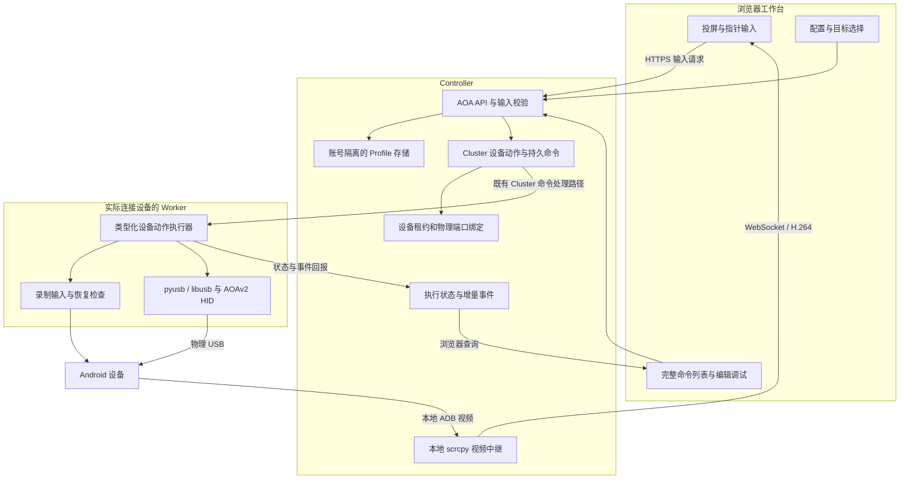
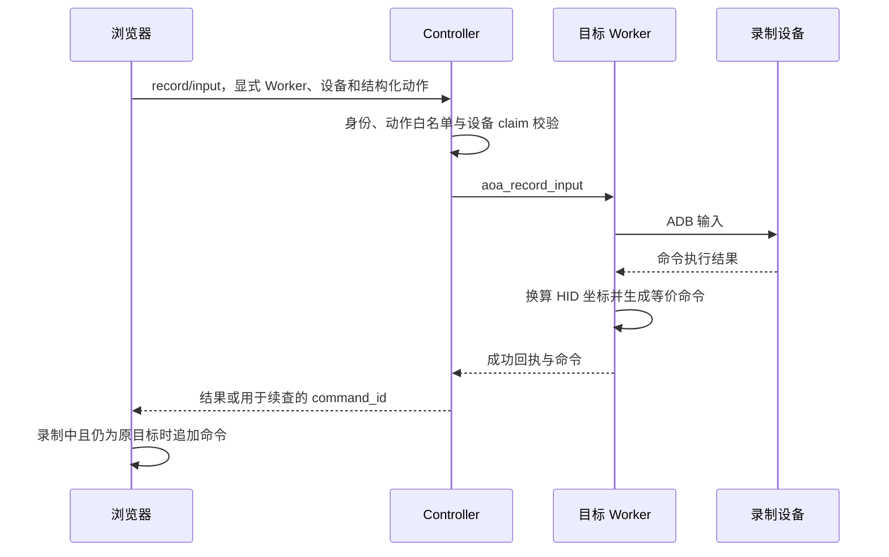
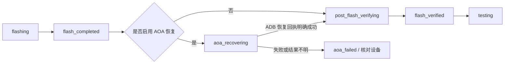

# AOA 工作台：原理、实现与系统架构

本文面向平台使用者、维护者和 Worker 部署人员，说明 GMS Remote Test 如何录制、
保存、调试和回放 AOA 命令，以及如何接入刷机后的 USB 调试恢复流程。

实现核对日期：2026-11-04。本文描述当前工作区源码；源码存在、自动化测试通过与
某块开发板的真机验收是不同结论。协议部分参考 Android 官方资料，实现部分以
文末列出的仓库模块为准。

## 1. 解决的问题与适用范围

user 固件刷写后，USB 调试可能关闭。此时依赖 ADB 的设置操作、截图、scrcpy 和
测试前检查无法直接使用。平台通过 AOAv2 HID 向 Android 发送触摸、按键和文本
输入，让设备按预先录制的路径进入设置并打开 USB 调试。

录制通常在 ADB 可用的 userdebug 设备上完成；目标机可以是同机型的 user 固件。
实际复用还要求初始界面、语言、方向、显示配置和系统向导版本相匹配。仅仅机型相同
不足以保证一组坐标命令能成功完成设置。

| 环节 | 当前采用的通道 | 是否依赖 ADB |
| --- | --- | --- |
| 录制时观察设备 | scrcpy 实时视频，或截图回退 | 是 |
| 录制时操作设备 | 白名单 ADB 输入动作，并生成等价 AOA 命令 | 是 |
| 触摸实测标定 | ADB 读取显示/输入信息，AOA 发送探测输入 | 是 |
| 目标设备单条调试、序列回放 | Worker 本地 pyusb/libusb → USB AOAv2 HID | 输入阶段不依赖 |
| 检查 USB 调试是否恢复 | Worker 查询 ADB 状态，并核对物理端口 | 是 |
| 恢复后启动测试 | ADB 启动状态及固件属性检查，再进入测试流程 | 是 |

“无 ADB 回放”指 HID 输入阶段，不表示录制、画面采集和恢复验收也不需要 ADB。
当前回放按命令顺序执行，不会通过视频识别页面或自动判断某个开关是否已经开启。

## 2. AOA / AOAv2 的工作原理

### 2.1 USB 角色和协议能力

Android Open Accessory 是 Android 与外部 USB 配件之间的协议。此处连接设备的
Worker 作为 USB Host，Android 作为 USB Device。AOAv2 增加 HID 输入能力，
可通过 USB 端点 0 的控制传输注册输入设备并发送事件。
协议本身不提供屏幕视频，也不要求先开启 USB 调试。
参考 [AOA 协议](https://source.android.com/docs/core/interaction/accessories/aoa) 和
[AOAv2 HID](https://source.android.com/docs/core/interaction/accessories/aoa2)。

平台的 HID 描述符、报文和命令解析由
[`foundation/aoa_profile.py`](../foundation/aoa_profile.py) 统一定义。
以下数值是当前实现使用的协议常量和设备描述方式：

| 控制请求 | 编号 | 在平台中的用途 |
| --- | --- | --- |
| `ACCESSORY_GET_PROTOCOL` | 51 | 读取协议版本，要求支持 AOAv2 |
| `ACCESSORY_SEND_STRING` | 52 | 发送配件标识字符串 |
| `ACCESSORY_START` | 53 | 请求进入配件模式，随后等待 USB 重枚举 |
| `ACCESSORY_REGISTER_HID` | 54 | 注册由配件分配 ID 的 HID 通道 |
| `ACCESSORY_UNREGISTER_HID` | 55 | 注销 HID 通道 |
| `ACCESSORY_SET_HID_REPORT_DESC` | 56 | 提交输入设备的 HID 描述符 |
| `ACCESSORY_SEND_HID_EVENT` | 57 | 发送触摸、键盘或系统键报文 |

本实现使用 vendor control transfer，输出方向 `bmRequestType=0x40`，
读取协议版本使用 `0xC0`；不通过 ADB Shell 转发这些 USB 请求。

### 2.2 一次回放的 USB 生命周期


执行器在已经处于配件模式时复用该模式；否则完成协商后重新发现目标。
它把 Google VID `0x18D1`、PID `0x2D00..0x2D05` 识别为 accessory 模式候选。
该判断不能替代设备的物理身份和租约检查。

切入配件模式及结束时复位 USB，可能触发短暂的断开、重连和 ADB 消失。
这些边界阶段的重枚举，与“发送 HID 时设备消失”是不同事件。
不能仅凭一组断开/连接时间戳认定回放成功，也不能把持续重连一概视为正常。

每条完整输入命令开始前，执行器重新核对 USB 总线地址、VID/PID，并用只读的
设备描述符请求检查原句柄是否仍有效。向导结束进入 Launcher 等阶段如果发生
重枚举，会在原物理端口上限时等待、重新进入 AOA 并注册 HID，然后从当前条命令
继续，已经完成的命令不重放。重连等待上限为 20 秒，并受原序列剩余预算约束。
如果断开发生在同一次滑动或按键输入的中途，则停止并报告该步骤已发送的报文数，
不能用重放整个手势来掩盖不确定的部分输入。

### 2.3 三类 HID 输入

| 通道 | 当前 HID ID | 报文 | 对应动作 |
| --- | --- | --- | --- |
| 触摸 | 3 | 5 字节：触摸状态、X 低/高字节、Y 低/高字节 | `click`、`longClick`、`swipe` |
| 键盘 | 1 | 2 字节：modifier、usage | `key`、`write` |
| 系统键 | 2 | 1 字节：wake/home/back 位标志 | `wake`、`home`、`back` |

这些 ID 是平台分配的 HID 通道标识，不是 AOAv2 规定的设备类型枚举。
回放在开始前按整段命令注册需要的通道：不含 `key/write` 的脚本不注册键盘，
纯等待不注册 HID。设备集合在序列内保持稳定，USB 重连后恢复相同集合。
旧模板默认使用兼容鼠标模式，保留原始指针描述符、坐标和设备端指针行为。
直接触摸模式作为可选项，描述符使用 Touch Screen Application、Finger 与 Contact
Identifier，走 Linux 直接触摸分类。两者报文均为五字节，但实际落点映射可能不同，
不能混用坐标和标定。输入设备在回放前注册，再等待默认 2 秒（可配 0..10 秒）。
模式随配置保存和导入导出，不按页面自动切换。兼容模式仍可能显示 Mouse 条目，
可在进入 System 后增加 sleep 等待布局稳定；等待不能消除条目引起的布局差异。
实现决策见 [ADR 0024](architecture/adr/0024-aoa-pointer-compatibility-and-input-modes.md)。
点击包含按下、抬起；键盘输入包含按下、释放；滑动按 10ms 步进生成中间点。
当前 `longClick` 回放按住约 1 秒，并不保留录制时任意长按时长。
某个 HID 通道注册失败时，对依赖它的动作报错，不能把协议版本探测成功等同于
该设备的所有输入类型均已验证。

## 3. 系统架构与职责



| 层次 | 职责与边界 |
| --- | --- |
| 浏览器 | 展示画面，采集交互，编辑命令，显式选择录制与回放目标，跟踪原命令回执 |
| AOA API / Service | 人类会话校验、账号隔离的配置管理、命令与参数校验，委托 Cluster 执行 |
| Foundation | 命令语法、运行预算、HID 报文定义，以及跨 Feature 的公共调用端口 |
| Cluster | Worker 归属、设备可用性、claim/fencing、持久命令、事件与控制请求 |
| Worker | 本地 ADB/USB 操作，持续校验租约，执行和清理，回报最终结果 |
| Automation | 冻结配置版本和设备身份，把恢复放在刷机与固件检查之间 |

浏览器不使用 WebUSB 直接控制机房设备；AOA 请求也不会被开放成任意 USB 请求代理。
本机 AOA 序列使用后台执行线程和持久命令，远端由现有 Worker 命令处理路径执行。
Worker 的注册、心跳、状态和事件回报使用带 Worker Token 的 HTTP(S)。涉及远程
Shell 的操作仍须遵守 [ADR 0004](architecture/adr/0004-ssh-execution-boundary.md)
中的统一 SSH 执行层；本文不增加新的 Shell 通道。

## 4. 画面通道、录制输入与坐标

### 4.1 画面通道独立于输入通道

Controller 本地 Worker 支持 scrcpy 纯显示视频：设备侧编码 H.264，经后端
WebSocket 中继到浏览器，由 WebCodecs 解码到 canvas。scrcpy 使用
`control=false`，点按和键盘操作统一走录制输入 API，以保证每次成功操作都能生成命令。

当前实时流 API 拒绝远程 Worker；远程设备或实时流失败时使用既有截图通道。
截图回退约每 1.2 秒刷新一次，实际频率受命令和网络耗时影响。
实时画面也不保证恒定帧率。ADB 关闭或 AOA 切换 USB 模式时，两类画面源都可能中断。

进入工作台仅加载配置和设备清单。选择录制设备后才自动尝试连接画面；初始化不隐式
执行输入、标定或保存配置。画面和空态共用固定投屏区域，等比缩放；三列利用页面
剩余空间，长命令列表内部滚动，设备选择和画面方向变化不重新撑开桌面布局。

### 4.2 一次交互录制



工作台从左到右为①设备投屏、②UI 操作对应命令、③AOA 录制 / 配置。投屏列较窄，
命令列更宽，以便同时查看动作和注释；窄屏依次换行，阅读与键盘焦点顺序一致。

每条命令与注释在同一行分为两列，右侧注释框可直接添加、编辑或清除说明，Enter 或移开焦点提交编辑、Esc 取消。
保存配置或导出时会提交正在编辑的注释；注释跟随删除、撤销和新增命令保持逐条对应，
存放在 `metadata.command_comments` 字符串数组中，JSON 导入导出完整保留。
单条最多 240 字、总大小最多 64 KiB；注释仅作说明，不参与命令解析和 HID 输入。

普通录制动作经 ADB 执行，成功后才加入中间的命令列表。默认在非 `sleep` 动作后附加
`sleep 800`，供回放留出界面切换时间。它不代表页面一定能在 800ms 内完成加载。

浏览器先按显示元素的实际矩形，把指针位置换算成画面像素；Worker 再换算成
360×640 HID 逻辑坐标。默认按 AOSP 触摸映射公式（分母为 Logical Maximum + 1）
取逆换算，结果按边界取整、限制：

```text
scale_x = 显示宽度 / 361
scale_y = 显示高度 / 641
logical_x = round(pixel_x / scale_x)
logical_y = round(pixel_y / scale_y)
```

canvas 和截图元素保留实际宽高比；留黑边属于投屏容器，不应当作画面坐标。
浏览器对点按、长按和滑动传递画面像素及 `frame_size`。实时流最长边限制为
1024 像素，不能直接用视频像素执行 ADB 输入：Worker 读取主显示器当前逻辑尺寸，
将画面像素换算到设备像素，再执行 ADB 输入并生成等价 HID 命令。原分辨率截图
的尺寸换算相同。视口解析兼容 InputReader 的方括号、无引号设备标识及
DisplayManager 的 `Rect(...)` 格式；InputReader 未提供可用主屏视口时读取
DisplayManager 核对，仍须识别唯一有效的主显示器，不使用 scrcpy 虚拟显示器代替。
未携带 `frame_size` 的既有 API 调用仍使用设备像素。画面与当前
显示方向不匹配时拒绝输入，等待新画面后重试。视频缩放换算与 HID 实测标定相互独立。
默认比例换算不是自动适配所有 OEM 输入映射的保证，只能作为
`direct_unverified` 初始坐标。

### 4.3 实测标定

“触摸标定”会通过 AOA 发送探测点击，再结合 ADB 输入信息计算映射，因此会
真实点击设备并切换 USB 模式。由操作者明确触发，并先打开专用安全标定应用。
录制机需安装 [AOA Calibration](../worker_agent/calibration_app/README.md)。
应用缺失/启动失败时不发送探针，不再在 Settings 页面降级点击。

多点仿射标定（ADR 0026）：五个探针点（四角 25%/75% 内缩 + 中心）实测
InputReader cooked 坐标，最小二乘拟合 HID→屏幕仿射（覆盖缩放、偏移与轴间
耦合），另测两个独立点，保留每点残差并输出 RMS/最大误差；最大误差超过 8px
判定失败。失败时 `success=false`；纯估算为 `measured=false`。direct 实测修正
使用 `direct_calibrated`，pointer 使用 `pointer_calibrated`；不能仅因拟合成功
提升为 `direct_standard`。旧记录缺少独立验证点时需要重标。
边界与策略详见 [ADR 0027](architecture/adr/0027-aoa-validated-mapping-boundaries.md)。

标定上下文包括版本、型号、Android 版本、显示尺寸、旋转方向和 HID 模式，当前版本为 3。
已有 version 2+ 且无模式字段的标定按直接触摸处理；新标定明确区分 pointer/direct。
旧版指针设备映射缓存不再沿用，需重新标定。录制输入复用实测标定时，Worker
核对上下文；发生变化会拒绝沿用，页面清除失效缓存并提示重新标定。
Web 缓存按 Worker/设备分区，保存配置时可把标定写入 `metadata.calibration`；
Controller 侧另有 `aoa_calibrations` 持久化表（owner 隔离），按
model + Android 版本 + 指纹 + 密度 + 显示 + 旋转 + HID 模式 + 内核 + 显示路由
匹配复用；信息缺失或变化时不自动复用。保存状态和记录 ID 在页面显示，保存
失败有明确提示。目标环境由 Worker 清单提供，源 Profile 不能代替目标证据。

普通配置 metadata 是保留标定和适用性信息的容器，不能当作回放时自动识别页面、自动
验证目标机型或完成视觉闭环的保证。跨分辨率时先将源像素按目标/源宽高归一化，
再反解目标 HID 坐标；不同旋转拒绝转换。Controller 请求模型完整传递两套映射，
Worker 连续、单条回放和调试只转换一次，本机及远程烧写恢复均使用冻结的映射。

需要类别免逐台标定、具名目标、布局匹配及每步页面断言时，使用独立的
[认证语义模板](aoa-semantic-templates.md)。它要求完成参考机证据签发，只在实测固件/显示配置下
启用 `direct_standard`；普通仿射映射继续不允许自行提升策略。未开启 ADB 的设备需要绑定外部画面源。

`metadata.hid_touch_mode` 为 `pointer`（兼容鼠标）或 `direct`（直接触摸），
`metadata.hid_settle_seconds` 为注册后等待时间。回放结果返回本次使用的模式与等待值。
`metadata.hid_session_mode` 默认为 `continuous`，整段保留 HID；显式设为
`per_command` 时每个输入后清理 USB，等待命令在原生 USB 状态下执行。
旧鼠标坐标如 `click 180 525` 不应直接替换成在直接触摸模式调试的 `click 180 580`。

“单条调试保持 HID 连接”使用同一个持久回执和设备锁接收用户逐条输入，首次按
完整命令列表冻结 HID 通道，以便在与连续回放相同的 Mouse 条目环境中验证坐标。
点击“结束调试”、离开 AOA 页签、空闲 2 分钟或累计满 15 分钟后清理；仅支持本机
Worker。网络故障不自动重发命令，进程中断后的 running 回执不重新执行。
生命周期细节见 [ADR 0025](architecture/adr/0025-aoa-debug-session-lifecycle.md) 与
[单条调试说明](aoa-playback-controls.md#单条命令调试)。

## 5. 命令语法与运行约束

| 命令 | 示例 | 含义 |
| --- | --- | --- |
| `click X Y` | `click 180 320` | 在逻辑坐标点按 |
| `longClick X Y` | `longClick 180 320` | 长按；注意命令大小写 |
| `swipe X1 Y1 MS X2 Y2` | `swipe 180 500 500 180 150` | 在指定毫秒内从起点滑到终点 |
| `write TEXT` | `write test_01@example.com` | 逐字符键盘输入 |
| `key [N*]KEY ...` | `key 2*TAB ENTER` | 顺序发送白名单按键，可重复指定次数 |
| `wake` / `home` / `back` | `back` | 系统键 |
| `sleep MS` | `sleep 2000` | 等待指定毫秒 |

`key TAB ENTER` 表示依次按键，不是任意多键同时按住。键名及 modifier 由白名单
生成，不接受任意数字 usage。`write` 当前支持英文字母、数字、普通空格及
`@ - _ .`，不支持中文、换行或 `+`，也拒绝以 `-` 开头的文本。
实际可接受内容以 `parse_profile_commands()` 为准，不以输入框提示代替校验。

| 限制 | 当前值 / 语义 |
| --- | --- |
| Profile 命令数 | 1..256 条；附加的 `sleep` 也计数 |
| 逻辑坐标 | X：0..360，Y：0..640；保存、执行时均校验 |
| 单条 `sleep` | 1..10000ms |
| 单条 `write` | 最多 128 字符 |
| 按键重复次数 | 每个 `N*KEY` 为 1..32 次 |
| 序列估算预算 | 300000ms；包括等待和动作估算，不只是 `sleep` 总和 |
| 自动恢复总预算 | 960 秒，覆盖执行、ADB 等待及恢复余量 |
| 累计暂停预算 | 600 秒；交互受控回放的查询等待预算另加该余量 |
| ADB 恢复等待 | 自动恢复为 1..600 秒；单条调试使用 0，不等待 ADB |

旧 [ADR 0022](architecture/adr/0022-web-aoa-recording-and-usb-recovery.md) 中的
64 条描述是初始决策时的值；当前上限以 Foundation 常量 256 为准。
执行器还有实际运行期限，预算耗尽会停止，不保证估算值就是实际墙钟耗时。

## 6. Profile、编辑与调试

仓库中的可复用 JSON 模板统一放在
[`configs/examples/aoa/`](../configs/examples/aoa/README.md)，采用
`<model>-<firmware>-<scenario>.json` 命名，例如
[`rk3576-ss17-wizard-to-usb-debug.json`](../configs/examples/aoa/rk3576-ss17-wizard-to-usb-debug.json)。
模板文件与账号 Profile 分开管理；需要先通过 Profile API 保存为当前账号的配置，
才能在 AOA 工作台和固件烧写弹框中选择，文件放入目录不会自动导入。

Profile 使用 SQLite 持久化，按 `owner_id` 隔离；同账号名称唯一。主要字段为
`id`、`name`、`description`、`commands`、`wait_adb_seconds`、`metadata`、
`revision` 和创建/更新时间。更新递增 revision；结构迁移在 `BEGIN IMMEDIATE`
写锁内检查、修改，避免多进程并发迁移。

推荐操作顺序：

1. 选择录制 Worker 和 ADB 可用设备，确认画面与实际设备一致。
2. 必要时显式标定，开始录制，完成一条已知初始界面的操作路径。
3. 载入或检查完整命令列表，调整坐标与等待时间。
4. 选择目标回放 Worker 和设备，使用每行“执行”逐条调试。
5. 用“开始回放”验证整段路径；确认后“保存当前命令”持久保存。

行内“编辑”打开输入框，“保存”或 Enter 应用修改，“取消”或 Escape 放弃草稿。
单条执行、回放、导出和保存配置前，会先应用正在编辑的草稿；空命令阻止操作。
当前列表来自所选 Profile 时，回放使用编辑后的列表；选择其他 Profile 则使用
该配置内容。编辑和调试本身不会自动向服务器保存配置。

每行“执行”发送 `aoa_commands: [该条命令]`、`wait_adb_seconds: 0`，不附带
前后步骤，不等于恢复 ADB。每次单条调试也有完整的 USB 建连与清理生命周期，
所以比连续序列多次切换 USB。整段回放及其暂停期间禁止交叉单条执行和修改。

Web 导出的 JSON 格式示例：

```json
{
  "version": 1,
  "name": "示例路径-需按实际界面修改",
  "wait_adb_seconds": 60,
  "commands": [
    "wake",
    "sleep 1000",
    "click 180 320",
    "sleep 800",
    "key TAB ENTER"
  ]
}
```

该示例只说明格式，不是可直接用于任意设备的恢复脚本。当前 Web JSON 导出包含
上述字段，不是包含 owner、revision、metadata 等字段的数据库完整备份。

## 7. 持久回放、过程控制与结果

序列派发返回 `accepted=true` 和 `command_id`，表示操作已被接受，不表示执行成功。
浏览器查询原命令的状态和增量事件，本机执行与远端执行采用相同的可跟踪回执语义。

| 标识 | 用途 |
| --- | --- |
| `command_id` | 查询本次操作及最终结果 |
| `operation_id` | 派发去重；自动化按 run/action 形成稳定键 |
| `request_sha256` | 把同一幂等键绑定到账号、目标和规范化请求 |
| `playback_control_id` | 将暂停/继续/停止绑定到原回放 |
| `control_revision` | 控制请求排序，避免旧的暂停覆盖新的继续 |

开始、完成、暂停、继续和失败等事件携带 `phase`、`index`、`total`、`command`。
事件序号独立于步骤号，允许同一步产生多次状态事件。Web 约每 500ms 查询事件并高亮
当前行；网络抖动可能使显示延后。事件上报失败不应改变已执行的物理输入。

暂停在当前完整命令结束后生效，不截断点击的按下/抬起或一次滑动。暂停期间保留
租约，并持续验证 fencing；继续执行下一条，不重新派发整个序列。停止结束后续
命令并执行清理，已经发生的输入不能撤销。停止回放可能以带取消信息的失败回执结束，
不能仅按一个 `cancelled` 状态字符串判断所有路径。

本机控制从持久命令读取；远端控制通过绑定原命令的控制消息交给 Worker 注册表。
控制必须匹配账号、Worker、控制句柄与原命令，终态不能继续。

结果关注以下字段；不同路径可能缺少不适用的字段，不能把缺失默认为成功：

| 字段 | 解释 |
| --- | --- |
| `success` | 当前动作/恢复结果；还需结合命令终态和调用场景 |
| `commands_total` / `commands_executed` | 序列命令数 / 已完成命令数，包含 `sleep` |
| `native_mode_restored` | 清理后是否确认恢复原生 USB 模式 |
| `cleanup_errors` | 分步骤清理诊断，不覆盖最初的执行错误 |
| `reconcile_required` | 需要核对设备和原操作状态，不应直接重放 |
| `adb_recovered` / `adb_state` | 是否在规定等待内得到 ADB `device` 状态 |
| `usb_port_path` | 与目标物理 USB 身份相关的结果信息 |
| `usb_reconnections` | 序列在完整命令边界重建 USB/HID 会话的次数 |
| `failed_index` / `failed_command` | 中断所在的命令，不等于命令已经送达 |
| `failed_input_state` / `failed_reports_sent` | `not_sent` 表示本条未尝试 HID 发送；`uncertain` 表示已尝试发送，结合成功返回的报文数核对部分输入 |
| `last_input_index` / `last_input_command` | 上一条完成报文发送的输入，不包含 `sleep`，也不证明点击命中了预期控件 |

输入发出、序列执行完成、原生 USB 恢复、ADB 恢复和固件验证是不同检查点。
尤其 `unauthorized` 代表设备尚未信任当前主机，仍需在设备上确认授权。

## 8. 身份、安全与清理

AOA 探测、交互录制、回放和配置 API 要求人类会话；自动化通过既有机器身份和
运行预约约束调用 Cluster 设备动作。不能据此推导出所有机器身份都能直接调用 Web AOA API。

设备选择必须携带 Worker；租约绑定设备并加入物理端口别名，防止重枚举后新 serial
绕过旧租约。Worker 发现设备时沿绑定物理端口查找，不因同串号设备出现在其他端口
就回退过去。目标不唯一、原生 serial 改变或租约 generation 变化时拒绝继续输入。

每次 USB 写入、驱动分离和 reset 都要复核 fencing。租约失效时停止修改设备，
仍尽力释放本地主机资源并记录清理诊断。清理步骤独立执行，某一步失败不会掩盖
其他步骤的结果。

正常及异常结束都涉及释放输入、注销已注册 HID、USB reset、资源释放及原生模式
检查；需要等待 ADB 的请求随后做恢复检查。当前 HID 输入遇到设备消失时停止并
要求核对，不盲目重发。收到一次 USB 传输错误时，不能证明触摸按下等部分输入从未发生。

## 9. 自动化刷机后的接入

### 9.1 手动烧写弹框

测试界面的 **🔥 烧写固件** 弹框提供「通过 AOA 完成开机向导并开启 USB 调试」选项。
先在设备管理的 AOA 工作台保存、验证同机型和同版本页面布局的配置，再在烧写弹框
勾选恢复、选择配置，并填写启动等待时间（默认 60 秒，范围 0..600）。一次选择一台
本地 USB 设备；支持 Controller 本机 USB 和远端 Worker USB。USB/IP 源端烧写暂不
支持自动接续，勾选时在烧写前拒绝，不会先刷机再报告不支持。

服务器路径、本机分片上传的最终烧写请求、远端 Worker 暂存请求均携带
`aoa_profile_id` 和 `aoa_boot_wait_seconds`。后端按当前账号解析 Profile，在烧写前
固定命令、摘要、revision、ADB 等待时间和 USB 物理端口。Worker 必须声明
`firmware_aoa_recovery_v1`，缺少新契约时拒绝开始；需要同步更新 Controller 和 Worker。
未勾选时仍执行原有烧写流程。此选项需要人工管理员会话，普通固件 Agent 审批令牌
不包含额外的 HID 操作授权。

执行顺序是：烧写成功 → 等待原序列号、原端口的 Android USB 设备稳定启动 →
执行冻结的 AOA 命令 → 恢复原生 USB 模式 → 等待 `adb_recovered=true` → 报告整体完成。

触摸恢复的固件兼容声明是**可选强化**（ADR 0028 Revision 1）：未填写声明时按
未验证映射回放（`estimated` / `direct_unverified`，结果如实标注，不视为已验证
坐标）；一旦填写，声明全字段严格校验并随操作冻结，触摸恢复还需已验证的源/目标
映射。兼容声明描述经过实测的**刷后**环境，不能用刷前的 userdebug 指纹代替
user 固件。Controller 暂存及 Worker 烧写前核对实际固件 SHA-256；Controller 本机
烧写核对实际执行主机上的镜像摘要。声明存在而镜像不符时不开始烧写。声明、映射
及物理身份随操作冻结。

烧写弹框在文件上传、占用设备及创建烧写命令之前调用
`POST /api/cluster/firmware/preflight`，与正式烧写共用账号、目标环境、标定及
固件声明校验（声明缺失时放行为未验证回放）。失败时保留弹框并显示具体缺项，
文件尚未上传。暂存后仍须核对实际镜像摘要，正式执行时再次校验。

点击弹框中的“查看所选 AOA 配置 / 补齐固件声明”可进入所选配置，在折叠区域
读取、编辑并应用声明，再点击保存。编辑声明会保留原有实测源映射；“读取固件
声明”在无既有声明时按烧写目标设备的清单采集生成环境草稿（自动草稿不等于
实测声明，仍需人工补齐固件 SHA-256、验证人与证据后应用保存）。
声明只能记录已经完成的实测结果。

Profile JSON 的 `metadata.firmware_compatibility` 格式如下，字段必须替换为实际
实测证据；示例不是可直接使用的设备认证。导入、保存和导出会保留该 metadata。

```json
{
  "version": 1,
  "sha256": "填写实际固件的64位小写SHA256",
  "context": {
    "model": "填写目标型号",
    "release": "填写目标Android版本",
    "fingerprint": "填写目标固件完整指纹",
    "display": [1200, 1920],
    "density": 240,
    "rotation": 0,
    "hid_touch_mode": "direct",
    "kernel": "填写目标内核版本",
    "display_route": "填写实际显示路由"
  },
  "validated_by": "填写验证负责人",
  "validated_at": "2026-11-05T00:00:00+08:00",
  "evidence": "填写对应固件及输入布局实测记录的位置或编号"
}
```

目标固件应先在可控设备上完成标定和验证，将完整目标环境及映射保存在同一账号。
自动化和烧写后触摸恢复缺少证据时提前拒绝；旧运行缺少冻结映射或声明时重新创建。
这套声明按固件验证，不能替代设备类别认证。标准 direct 必须使用另行签发的
[类别认证与语义计划](aoa-semantic-templates.md)，普通映射仍拒绝 `direct_standard`。
严格转换会拒绝不可达点和越界滑动端点。标定时除启动结果外，还在每次探针前检查
目标显示器、焦点及锁屏/遮挡，远端 Worker 必须支持 `aoa_calibration_focus_v1`。
实现决策见 [ADR 0028](architecture/adr/0028-aoa-firmware-bound-recovery-and-strict-environment.md)。
启动等待从 Android USB 设备出现起计算，最多额外等待 180 秒让设备重新出现；
Loader/Fastboot 不视为 Android 已就绪。无 ADB 时无法直接判断系统页面是否已加载，
应按实际首次开机耗时调整启动等待和脚本中的 `sleep`。

烧写与 AOA 验证期间持有同一烧写操作的设备锁和物理端口约束。远端恢复属于原
`flash_firmware` 持久命令，本机在发出 HID 前写入独立 AOA 回执；不会由浏览器在烧写
完成后另发一次点击请求。原序列号、端口或租约变化会停止，输入失败不自动重放。

只有烧写和 ADB 恢复都成功才报告整体成功。失败结果保留 `flash_success=true`，
明确提示「固件已烧写，AOA 恢复未完成」，此时在 AOA 工作台检查设备当前页面并单独
调试，无需重新烧写。`unauthorized` 仍需在设备上确认授权，不能据此宣称 ADB 已恢复。

实现入口：[弹框](../web/shell/dialogs/firmware.html)、
[烧写前端](../web/static/js/pages/firmware-burn.js)、
[本机恢复服务](../features/firmware/aoa_recovery.py)、
[快照与租约续接](../features/cluster/firmware_recovery.py)、
[Worker 恢复](../worker_agent/firmware_recovery.py)。

### 9.2 自动化测试运行

官方 ATS 也把 AOA 动作安排在刷机后，用录制的 UI 路径重新启用 USB 调试。
参见 [ATS user builds 流程](https://source.android.com/docs/core/tests/development/android-test-station/ats-user-builds)。
平台自动化实现的顺序为：



创建 run 时按账号解析 Profile，冻结命令、SHA-256、Profile ID/revision、等待时间
和 metadata，排队后编辑配置只影响新 run。刷机前冻结物理 USB 身份并核对 Worker
能力。自动恢复首先检查原物理端口的 ADB，已经在线时跳过 HID，避免再次点击开关。

自动化恢复要求明确的 `success=true`、`adb_recovered=true`、`adb_state=device`
回执，然后再检查系统启动、产品和 fingerprint。失败或结果不完整时不启动测试。
响应丢失继续跟随同一 operation/command，不能把查询重试实现为从第一条重放。
结果不确定时保留设备预约并要求核对。

## 10. 主要 API 与源码导航

以下是接口职责索引，不是免鉴权调用示例。设备目标和权限仍由服务端校验。

| API | 用途 |
| --- | --- |
| `GET/POST /api/devices/aoa/profiles` | 列出 / 创建账号配置 |
| `GET/PUT/DELETE /api/devices/aoa/profiles/{profile_id}` | 查询 / 更新 / 删除配置 |
| `POST /api/devices/aoa/profiles/from-recording` | 保存录制命令 |
| `POST /api/devices/aoa/probe` | `GET_PROTOCOL` 探测，不执行完整录制路径 |
| `POST /api/devices/aoa/record/input` | 一次结构化录制输入 |
| `GET /api/devices/aoa/record/presets`、`POST /api/devices/aoa/record` | 预置录制流程及执行入口 |
| `POST /api/devices/aoa/recover` | Profile 或内联命令回放，并等待 ADB；等待至少 1 秒 |
| `POST /api/cluster/devices/actions` | 类型化设备动作；单条调试使用 `aoa_sequence` 且等待为 0 |
| `GET /api/cluster/commands/{command_id}` | 查询持久操作状态和结果 |
| `GET /api/cluster/commands/{command_id}/events` | 按事件游标增量读取进度 |
| `POST /api/devices/aoa/playback/{control_id}/control` | 暂停、继续、停止原回放 |
| `POST /api/devices/aoa/record/stream/{serial}/start`、`stop` | 本地实时视频会话生命周期 |
| `WS /api/devices/aoa/record/stream/{serial}` | 本地纯显示视频流，不接受 UI 输入 |

| 模块 | 代码入口 |
| --- | --- |
| 页面与布局 | [devices.html](../web/shell/pages/devices.html)、[aoa-workbench.css](../web/static/css/aoa-workbench.css) |
| 录制、命令编辑、调试和过程展示 | [shell-aoa.js](../web/static/js/shell/shell-aoa.js) |
| 浏览器视频解码与截图回退 | [aoa-live-screen.js](../web/static/js/shell/aoa-live-screen.js) |
| AOA API、Profile 存储 | [aoa_api.py](../features/devices/aoa_api.py)、[aoa_service.py](../features/devices/aoa_service.py) |
| 纯显示 scrcpy 会话 | [scrcpy_stream.py](../features/devices/scrcpy_stream.py) |
| 命令语法、预算和 HID 报文 | [aoa_profile.py](../foundation/aoa_profile.py) |
| 设备动作、持久回执和控制 | [device_actions_api.py](../features/cluster/device_actions_api.py)、[device_action_operations.py](../features/cluster/device_action_operations.py)、[aoa_playback.py](../features/cluster/aoa_playback.py) |
| Worker 设备动作入口 | [device_actions.py](../worker_agent/device_actions.py)、[app.py](../worker_agent/app.py) |
| USB 执行、录制输入和恢复 | [aoa_actions.py](../worker_agent/aoa_actions.py) |
| 命令边界的 USB 会话重建与 HID 注册 | [aoa_session.py](../worker_agent/aoa_session.py) |
| 物理身份、标定、暂停控制 | [aoa_usb.py](../worker_agent/aoa_usb.py)、[aoa_calibration.py](../worker_agent/aoa_calibration.py)、[aoa_control.py](../worker_agent/aoa_control.py) |
| 自动化快照与恢复状态机 | [aoa_snapshot.py](../features/automation/aoa_snapshot.py)、[recovery_executor.py](../features/automation/recovery_executor.py)、[orchestrator.py](../features/automation/orchestrator.py) |

## 11. 部署条件与已知边界

实际执行设备的 Worker 需要 Python pyusb、可用的 libusb 后端和 USB 访问权限。
录制、标定和 ADB 恢复检查还需要 platform-tools。本地实时投屏另外依赖平台配置
的 scrcpy-server 和浏览器视频解码能力。

| 能力声明 | 作用 |
| --- | --- |
| `aoa_record_input_v1` | 录制输入基础能力，当前探测依赖 ADB 工具可用性 |
| `aoa_usb_hid_v1` | pyusb 输入基础能力 |
| `aoa_identity_fencing_v1` | 物理身份和持续租约校验契约 |
| `aoa_playback_control_v1` | 暂停、继续和停止契约 |
| `firmware_aoa_recovery_v1` | 手动烧写命令内接续 AOA、等待启动并验证 ADB |
| `aoa_hid_modes_v1` | 明确选择兼容鼠标/直接触摸并遵守输入稳定等待 |

能力声明不代表某块板已经通过协议、权限、HID 描述符和恢复流程的真机验证。
远端缺少安全契约或过程控制能力时，相关操作在 Controller 侧拒绝。
Controller 与 Worker 需要匹配更新，刷新网页不能给旧执行器补上这些能力。

主要边界如下：

- 优先使用 Worker 本地直连 USB。ADB Proxy 只提供 ADB 能力，不能代替 AOAv2 USB 控制传输。
- `usb_only` 是 USB 候选状态，可用于探测/恢复，不代表截图和普通 ADB 操作可用。
- USB/IP 不能因设备名称相同就假定支持重枚举全过程，需要单独验收。
- 远端 Worker 当前没有本地 scrcpy API 的实时视频中继能力，使用截图路径。
- 坐标脚本不是跨语言、跨 OEM 的通用导航器，也不保证处理锁屏、FRP、企业策略。
- 回放不会绕过 Android USB 调试授权；恢复成 `unauthorized` 仍需设备端确认。
- 录制动作的 ADB 成功回执不能证明目标机 AOAv2 回放必然产生相同界面效果。

部署方式见 [部署入口](deployment/quick-install.md) 与 [Worker 文档](deployment/worker.md)。

## 12. 故障判断与排查顺序

| 现象 | 判断与处理方向 |
| --- | --- |
| 切换 AOA 或结束时短暂断开重连 | 可能是预期重枚举；结合原生模式恢复和操作回执判断 |
| `device vanished while sending HID` | 输入中连接丢失；停止核对设备、原命令和物理连接，不直接重放 |
| `step 19/… , report N, M reports sent` | 把失败定位到命令内的第 N 个报文；前 M 个已发送，存在部分输入，不能自动重发 |
| 后续 `release_*`、`unregister_hid_*`、`reset_usb` 报错 | 常是同一失效 USB 连接引发的清理诊断；先查最初执行错误 |
| `native_mode_restored=false` | 未确认退出配件模式，不能视为已恢复正常 USB 状态 |
| `adb_state=unauthorized` | USB 调试可能已开启，但主机尚未获得授权 |
| `adb_state=identity_mismatch` / `ambiguous` | 物理身份不匹配或候选不唯一，拒绝继续比选择第一台设备更重要 |
| 标定上下文变化 | 型号、版本、方向或显示配置变化，重新标定 |
| 命令完成但设置未达到预期 | 核对初始页面、等待时间、坐标、语言与固件，输入完成不等于页面目标达成 |
| System 出现 Mouse、Developer options 位置改变 | 检查新 AOA 会话是否采用直接触摸描述符、脚本是否需要键盘；先确认输入分类与实际布局，再调整坐标 |
| 远程实时视频返回 422 | 当前仅支持 Controller 本地 Worker 实时流，使用截图通道 |
| 长错误信息 | 顶部单行省略，悬停查看；完整信息在结果框内滚动，不应撑开页面 |

现场建议先记录 Worker、设备、原 `command_id`、最后完成步骤和第一条错误，再查看
同一时段设备连接事件、原回放事件与清理结果。必要时由现场人员检查连接和设备状态。
不要把控制台一句“已连接”、步骤进度或重新打开页面当作原操作成功的证据。

### 12.1 开启 USB debugging 时中断

例如第 61 条 `click 320 320` 完成、第 62 条 `sleep 3000` 完成，随后第 63 条
`click 180 280` 显示 `reconnecting` 并超时，说明第 63 条在 USB 预检/建连时
已中断；不能据此认定它点错了弹框。失败回执记录本条是否尝试过 HID、上一条
输入及已完成数量。旧日志仅有 `running` 或 `completed` 时，不能推断屏幕实际状态。

需要区分两类弹框：开启 USB 调试的设置确认，以及包含电脑 RSA 指纹的主机授权。
两者的按钮坐标和出现时机需要分别验证。恢复脚本不应通过重复点击开关来保证开启，
否则第一次成功后，第二次可能将调试关闭。清刷后也不能假定开关状态与上次调试一致。

启用 ADB daemon 抑制的连续回放，会在 USB 清理结束后才恢复主机 ADB 查询。
因此不应把 RSA 授权点击安排成开启确认之后固定延迟的盲点操作。应先核对实际弹框，
在出现授权请求后由设备端确认。HID 报文发送完毕与主机授权完成分别验收。

完整回放结束后，旧 USB 句柄可能随重枚举失效。若已取得原串号及物理端口的
授权 ADB，并再次读取确认同一目标已处于原生 USB 模式，`reset_usb` 和
`restore_native_mode` 的过渡性诊断转存为 `cleanup_warnings`，不再误判恢复失败。
其他清理异常、回放中断或仍在 accessory 模式都不会因此变成成功；复核不重发 HID、
不重置 USB，也不重新烧写。错误信息分别说明 ADB、授权或 USB 恢复的真实失败阶段。

需要等待 ADB 的回放若中途失败，执行器在清理和抑制结束后，以原串号及原物理端口
进行一次 ADB 状态检查。`unauthorized` 提示核对电脑授权，`device` 表示 ADB 已可用，
但二者都不会把中断的回放改成成功，也不会自动继续剩余点击。取消、租约失效或其他
抑制会话仍存活时不启动该检查；检查失败保留最初的 USB 错误。

现场匹配最后几步应保留当前页面，分别记录开关确认框和 RSA 框的标题、按钮、坐标
以及每步操作后 USB/ADB 状态。只调试已确认的剩余步骤，无需重新烧写或重放整个向导。

## 13. 验证与后续维护

软件回归覆盖语法和预算、Profile 隔离、物理端口身份、claim/fencing、快照冻结、
幂等派发、异常清理、暂停顺序，以及前端录制、编辑、单条调试和布局切换。
相关入口为：

- [AOA Profile/API 测试](../features/devices/tests/test_aoa_profiles.py)
- [Cluster AOA 操作测试](../features/cluster/tests/test_aoa_operations.py)、[回放控制测试](../features/cluster/tests/test_aoa_playback.py)
- [自动恢复测试](../features/automation/tests/test_aoa_recovery.py)
- 手动烧写接续：[烧写 API](../features/firmware/tests/test_aoa_recovery.py)、[快照与租约](../features/cluster/tests/test_firmware_recovery.py)、[Worker](../worker_agent/tests/test_firmware_recovery.py)、[弹框与上传路径](../tests/runtime_ui/test_firmware_aoa.py)
- [Worker 执行测试](../worker_agent/tests/test_aoa_actions.py)、[USB 身份测试](../worker_agent/tests/test_aoa_usb.py)、[控制测试](../worker_agent/tests/test_aoa_control.py)
- [浏览器工作台测试](../tests/runtime_ui/test_aoa_workbench.py)

USB 桩和模拟接口回归不能代替真机验收。具体板型至少需要验证：ADB 关闭后的输入、
协议与 HID 通道兼容、重枚举和原生模式恢复、授权未完成、连接中断、两个同型号设备
并接、语言/方向变化，以及完整刷机到固件验证再到测试的路径。

后续修改优先同步本说明中的能力范围、预算、接口和结果语义，避免把历史分析中
的计划或源码旧注释当成当前行为。专项过程说明见
[命令轨道与控制](aoa-playback-controls.md)，历史背景见
[接入分析](ats-user-builds-aoa-analysis.md) 和
[ADR 0022](architecture/adr/0022-web-aoa-recording-and-usb-recovery.md)。
