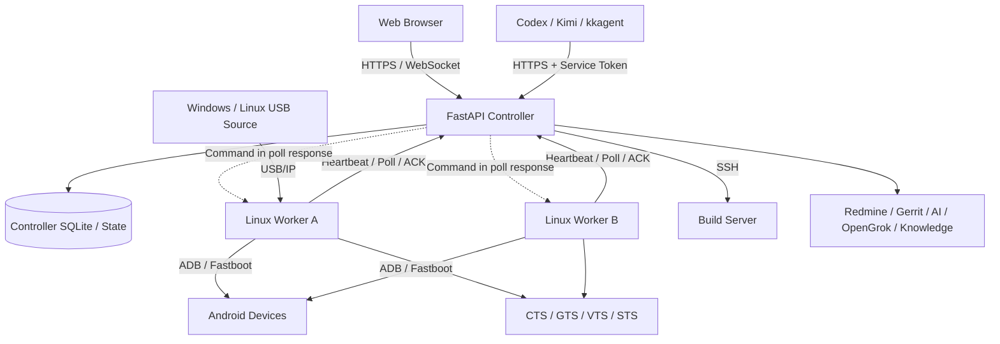

# 架构总览

GMS Remote Test Web 是面向 Android GMS 认证测试场景的远程测试与设备调度平台。它把分散在不同主机上的 Android 设备、GMS 测试套件、固件、构建服务器和测试结果统一到 Web 平台管理，覆盖 CTS / GTS / VTS / STS 测试工作流，以及设备共享、测试调度、固件烧录、报告分析、构建任务、自动化与外部系统集成。

## 总体拓扑



本图的规范源为 [`platform-topology.mmd`](platform-topology.mmd)，README 与 Web 架构页由契约测试约束为同一组角色和消息方向。

## 业务流程与双平面说明

Web「系统架构」另提供两个独立的流程图：

- [测试执行闭环](test-flow-topology.mmd)：Web / Agent 意图 → Controller 鉴权、设备 Claim 与套件预检 → ATS / Cluster Job → Worker Poll、Tradefed / ADB → 原生日志 / 登记报告 → 可选 AI 诊断。**原生套件目录与已登记报告不是同一个存储**。
- [Agent 工单诊断](agent-analysis-topology.mmd)：Agent 工具规划 → Controller 校验入队 → 分析 Worker 取证预检（工单证据、版本匹配、Mainline / Critical Fix / 安全补丁正文及规范召回）→ 模型分析、Evidence Gate 与 Claim Review → 状态和报告落库。Agent 按 run_id 查询并回送原会话；后台任务与 Agent 跟踪生命周期分开。此分析 Worker 是 Redmine 后台服务，不是设备执行 Worker。

USB/IP 数据面中设备**物理连接在 Source 主机**，Worker 使用 `vhci_hcd` 虚拟 USB 总线访问设备；[USB/IP 拓扑](usbip-topology.mmd) 不应画成设备重新物理连接 Worker。本地 USB 烧写与 Windows Source-side Flash 是两条不同的路径，见 [固件烧写拓扑](firmware-topology.mmd) 和 ADR 0005；Linux Source 的整包固件烧写尚未实现，拒绝而不是跨 USB/IP 勉强继续。

USB/IP 的 Source 端 bind 经受审计 SSH（ADR 0004）；远端 Worker 的 attach 经认证命令队列（ADR 0001），命令随 Poll 响应返回。测试与烧写图同时展示下发和 ACK / 状态回报，原生测试结果仍保留来源边界。

Web「系统架构」的六个默认视图由 `web/static/js/pages/architecture-scene-data.js` 提供静态场景节点与连线，`web/static/js/pages/architecture-scenes.js` 负责绘制；`web/static/css/architecture-scenes.css` 统一视觉样式。页面仅解释逻辑关系，不提供实时服务健康或成功率数据。`docs/architecture/*.mmd` 仍是协议角色与消息方向的规范源；`features/system/topology_layouts.py` 与 `features/system/topology_view.py` 负责由规范 Mermaid 生成独立 SVG，供架构契约与文本路由验证。场景变更应同时校对对应的 Mermaid 节点、箭头方向和设备资源归属。窄屏保持图内滚动；桌面缩放优先可读性，不强制裁掉节点内容。 **独立规范 SVG 渲染器**仍使用统一 14px 节点字体、12px 箭头标签；这些尺寸是 `topology_view.py` 的渲染常量，不代表 Web 默认交互视图的 CSS 字号。

## 四个主要角色

Web「系统架构 → 平台总览」的「模块职责与依赖」按接入、Controller、Worker、设备通道、外部协同、Knowledge、Bootstrap / Runtime 与 Feature / Foundation 展示职责。外部集成和构建
主机单独列示，具体部署关系与消息方向以总体拓扑为准。Worker 原生结果位于
套件 `results` / `logs`，从测试套件浏览器访问；已登记报告由 Controller
索引，从报告管理访问。

对话 Agent 默认由 kkagent 根据项目工具注册表规划，Controller 继续负责
鉴权、资源预检和执行；需确认的计划在预检通过后由用户确认。对话引擎与
报告分析模型分别展示状态，失败可显式重试，见 [ADR 0031](adr/0031-conversation-project-agent.md)。
工单分析使用匹配版本的 APK / SDK 证据，发布前逐段复核候选结论；复核不
代表根因已经由设备复现，见 [ADR 0036](adr/0036-analysis-claim-review.md)。

1. **Controller**：FastAPI 应用（入口 `app.py`）。负责 Web UI、认证、权限、任务调度、配置、报告、集群状态和外部系统集成。
2. **Worker Agent**（`worker/`）：运行在实际执行 GMS 测试的 Linux 主机上，负责 ADB、Fastboot、Tradefed、USB/IP Client、本地资源探测与任务执行。
3. **Device Source**：Android 设备物理 USB 所在主机。直接 USB/IP 来源工作流当前主要支持 Windows + `usbipd-win`（Ubuntu 来源支持设备共享、分配与重连）。
4. **Agent Runtime**（`agent/gms-remote-test/`）：运行在 Codex / Kimi / kkagent 所在主机，通过 `gms-rt` CLI 和 MCP Adapter 调用 Controller；不直接持有平台用户密码，也不绕过 Controller 的权限、审批和审计边界。

Worker 与 Controller 之间通过带 Token 的 HTTP(S) API 进行注册、Heartbeat、命令轮询和 ACK；Agent 使用独立的 Agent Service Token。生产环境要求 Worker 与 Agent 均通过受信任的 HTTPS Controller URL 访问平台。

## 数据与控制流

- **浏览器 → Controller**：HTTPS + Session Cookie（含 CSRF 防护），WebSocket 用于日志、进度与终端。
- **Agent → Controller**：`gms-rt` CLI / MCP，携带 Agent Service Token；破坏性操作需要一次性 Approval Token。
- **Controller ↔ Worker**：带 Worker Token 的 REST 注册 / Heartbeat / 命令轮询 / ACK，按 session 与 generation 管理重连。Controller 将类型化命令入队，Worker 拉取后执行并回报；需要 SSH 的主机操作仍受 ADR 0004 的统一执行器约束。
- **Worker ↔ Device**：USB/IP 导入后按本地 USB 设备语义访问（adb server / fastboot / upgrade_tool / Tradefed）。
- **Controller ↔ 构建服务器**：SSH Backend + 受控 Build Template（见 [ADR-0004](adr/0004-ssh-execution-boundary.md)）。
- **诊断读模型**：Web / CLI / MCP / Assistant 消费统一的 DiagnosisReadModel（canonical 七节，serve-time 投影、不落库，见 [AI 治理](ai-governance.md)）。

## 知识与诊断边界

- `features.knowledge` 提供公共联邦检索：Android Internals Wiki、CDD 与 Web 文档经 Provider 索引、RRF 排序及来源状态返回；命中为 `background`，不构成已验证根因。Wiki 的源码锚点可引导匹配版本的 SDK / CodeSearch 验证。
- Redmine `reference_recall.py` 从证据快照解析标识符和 Android 版本，召回官方引用及 Web 规范；owner 授权 PDF / HTML 与 GMS Requirements 另行校验授权，不并入公共索引。规范引用可以说明要求和适用条件，不证明当前问题的根因。
- 分析 Worker 使用只读证据工具、证据门禁与逐段结论复核；缺失证据须显式说明。设备验证是独立受控动作，报告或修复建议不意味着自动执行、提交 Gerrit 或回写工单。诊断状态与报告是权威结果，Web / Agent 通过读模型与 run_id 消费。

## 代码组织

```text
Feature
  ↓
Foundation / Port
  ↓
Infrastructure
```

- `features/`：业务 Feature（auth、cluster、devices、firmware、build、test_execution、gms、sdk 等），Feature 之间不互相 import 内部模块，共享逻辑下沉 `foundation/`（见 [ADR-0002](adr/0002-feature-foundation-boundary.md)）。
- `foundation/`：公共基础设施与跨 Feature Port（配置、响应、安全、SSH 执行器、进程边界等）；`runtime_contracts.py` 定义运行时类型契约。
- `bootstrap/`：组合根、服务组装与运行时依赖注入；Port 是调用契约，不是另一个独立部署服务。
- `agent/gms-remote-test/`：Agent Package 唯一手工维护源码树；`plugins/gms-remote-test/` 是生成结果。
- `worker/`：Worker 侧执行与 Controller 通信。
- `web/`：浏览器 Shell 与静态前端。

## 相关决策记录

完整索引（ID / Title / Status / Supersedes / Superseded by）见
[docs/architecture/adr/README.md](adr/README.md)。

关键入口：

- [ADR-0001 Controller / Worker 边界](adr/0001-controller-worker-boundary.md)
- [ADR-0002 Feature / Foundation 边界](adr/0002-feature-foundation-boundary.md)
- [ADR-0003 Agent Profile Store](adr/0003-agent-profile-store.md)
- [ADR-0004 SSH 执行边界](adr/0004-ssh-execution-boundary.md)
- [ADR-0005 USB/IP 固件烧写所有权](adr/0005-usbip-firmware-ownership.md)
- [ADR-0013 Daily Brief 统一诊断流水线](adr/0013-daily-brief-batch-matches-single-issue-diagnosis.md)
- [ADR-0014 外部知识联邦（background only）](adr/0014-external-knowledge-federation.md)
- [ADR-0019 对话 Agent 会话持久化与崩溃恢复](adr/0019-agent-session-persistence-recovery.md)
  （`data/assistant/agent_sessions.json` 恢复锚点：0600 + 原子替换 +
  跨进程 flock；监控连续性是 Controller 进程内语义，任务权威状态仍在
  Cluster Job 与报告）
- [AI 执行治理与诊断质量层](ai-governance.md)（execution receipt 账本、
  golden corpus、failure identity、section 级知识检索与全部门禁图）
